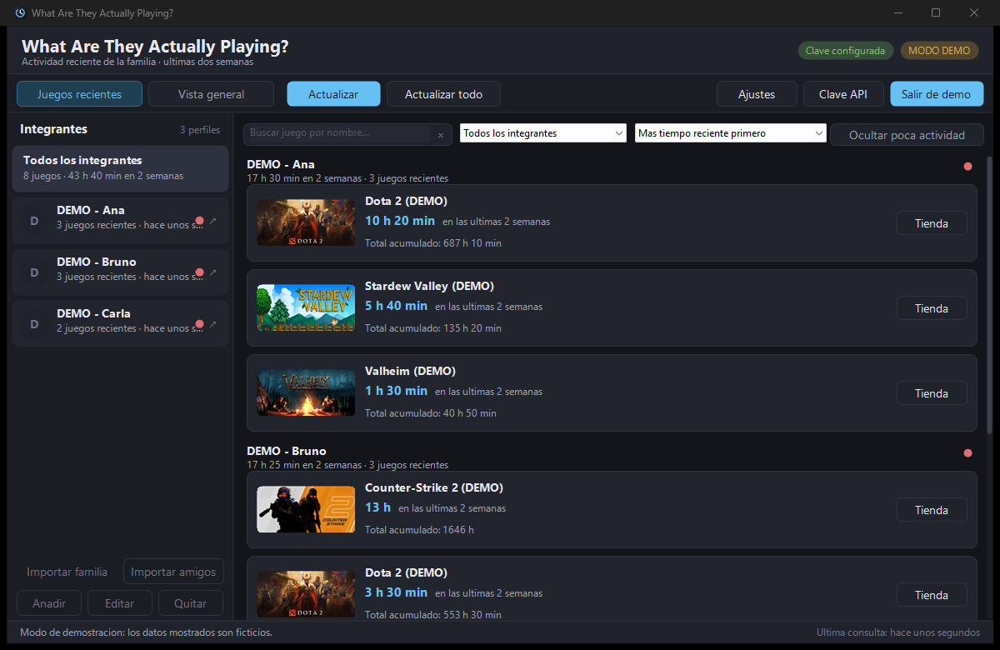
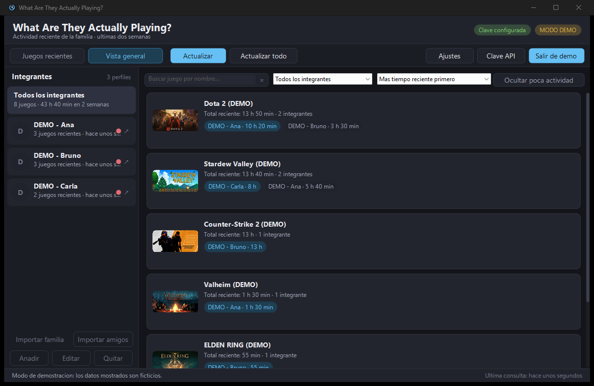

# What Are They Actually Playing? (WATAP)

**Visor nativo y ultraligero para Windows que muestra la actividad reciente de Steam de tu grupo familiar.**


WATAP reúne en una sola ventana qué ha estado jugando tu familia en Steam: minutos de las
**últimas dos semanas**, minutos **acumulados**, portadas y una **vista general** que combina
los juegos de todos los integrantes, para decidir a qué jugar.

Es una aplicación **nativa** (C++20 + Win32, dibujada a mano sobre GDI+) que se compila en un
único `.exe` con el runtime de Visual C++ enlazado estáticamente. **No** usa Electron, Chromium,
WebView2, Node, Python, .NET ni Qt: no hay que instalar nada para ejecutarla.

> ### 🚧 Proyecto en desarrollo
>
> WATAP está **en desarrollo activo y mejora continua**. Funciona de extremo a extremo y se ha
> probado con datos reales, pero todavía hay **ideas a medio desarrollar**, detalles por pulir y
> partes sin verificar del todo (ver [Limitaciones](#limitaciones-y-verificación)). La interfaz,
> las opciones y el formato de datos pueden cambiar entre versiones. Las sugerencias, ideas y
> informes de errores son bienvenidos.

---

## Tabla de contenidos

- [Capturas](#capturas)
- [¿Qué hace?](#qué-hace)
- [¿Qué NO hace?](#qué-no-hace)
- [Requisitos](#requisitos)
- [Compilación y pruebas](#compilación-y-pruebas)
- [Uso](#uso)
  - [1) Clave de Steam Web API](#1-clave-de-steam-web-api)
  - [2) Importar integrantes](#2-importar-integrantes)
  - [3) Consultar actividad](#3-consultar-actividad)
  - [4) Ajustes](#4-ajustes)
- [Datos locales](#datos-locales)
- [Privacidad y red](#privacidad-y-red)
- [Pruebas automáticas](#pruebas-automáticas)
- [Estado del proyecto y hoja de ruta](#estado-del-proyecto-y-hoja-de-ruta)
- [Limitaciones y verificación](#limitaciones-y-verificación)
- [Estructura del proyecto](#estructura-del-proyecto)
- [Tecnologías](#tecnologías)
- [Licencia](#licencia)

---

## Capturas

| Juegos recientes | Vista general |
| :---: | :---: |
|  |  |

> Capturas tomadas en **modo demostración**, con datos ficticios y claramente etiquetados.

---

## ¿Qué hace?

- **A. Integrantes.** Lista lateral con avatar, nombre público, número de juegos recientes y
  fecha de la última consulta. Permite añadir, editar y quitar integrantes.
- **B. Juegos recientes.** Tarjetas compactas por juego con portada, nombre, tiempo de las
  últimas dos semanas destacado y tiempo total acumulado. Botón para abrir la ficha en Steam.
- **C. Vista general.** Agrega y elimina duplicados de todos los integrantes, mostrando los
  minutos de cada uno por título y resaltando de forma discreta quién ha jugado más.
- **D. Filtros.** Elegir integrante o ver a todos, ordenar por actividad reciente, buscar por
  nombre y ocultar juegos por debajo de un umbral de minutos.

Además:

- **Importación automática de integrantes.** No hay que escribir SteamIDs: los botones
  **Importar familia** e **Importar amigos** detectan tu cuenta de Steam en el equipo y traen a
  los miembros de tu **grupo familiar** o de tu **lista de amigos**, con una lista para marcar a
  quién seguir.
- **Etiquetas de actividad Alta / Moderada / Baja** con umbrales configurables. Son datos
  históricos: **nunca** se presentan como "disponibilidad de copias" ni como estado en tiempo real.
- **Actualización** manual (de un integrante o de todos), **actualización automática** opcional
  mientras la app está abierta, indicador de la última actualización correcta y **caché local**
  de respuestas e imágenes.
- **Resiliencia de red.** Si falla la conexión, se muestran los datos en caché y se avisa de que
  pueden estar desactualizados.
- **Modo demostración** con datos ficticios para ver la interfaz sin credenciales.

## ¿Qué NO hace?

- No muestra estado "en línea" ni "jugando ahora".
- No usa scraping, cookies ni endpoints no documentados.
- No pide la contraseña de Steam.
- No instala servicios ni procesos en segundo plano.

---

## Requisitos

- **Windows 10/11 x64.**
- **Visual Studio** con herramientas de C++ (se compiló con Visual Studio 18 Insiders, MSVC
  14.50, Windows SDK 10.0.26100). Sirve cualquier VS 2022 con el conjunto de herramientas C++ y
  el SDK de Windows.
- **CMake >= 3.20** y **Ninja** (ambos se incluyen con Visual Studio).
- **Sin dependencias externas:** `nlohmann/json` va incluido como cabecera en
  `third_party/nlohmann/json.hpp`.

Operativamente, para obtener la actividad de otras personas necesitarás:

- una **clave de Steam Web API** (gratuita), y
- el **cliente de Steam instalado** en el equipo, para detectar tu cuenta y tu grupo familiar.

## Compilación y pruebas

La forma más rápida, desde la raíz del repositorio:

```powershell
powershell -ExecutionPolicy Bypass -File .\build.ps1 -Config Release -Test
```

Opciones del script:

- `-Config Debug` para una compilación de depuración.
- `-Test` compila y ejecuta la batería de pruebas de consola.
- `-Clean` borra el directorio `build\<Config>` antes de compilar.

El script localiza Visual Studio con `vswhere`, carga `vcvars64.bat`, configura CMake con el
generador Ninja y compila. Los binarios quedan en:

```
build\Release\WATAP.exe             (aplicación GUI)
build\Release\srp_tests.exe         (pruebas)
```

### Compilación manual (equivalente)

Desde un símbolo del sistema con el entorno de MSVC ya cargado (`vcvars64.bat`) y con
`cmake`/`ninja` disponibles:

```bat
cmake -S . -B build\Release -G Ninja -DCMAKE_BUILD_TYPE=Release
cmake --build build\Release
ctest --test-dir build\Release --output-on-failure
```

---

## Uso

Al abrir la app por primera vez, si no hay integrantes ni clave de API, se activa el **modo
demostración** con datos ficticios (`DEMO - ...`) para que puedas ver la interfaz. Para usar
datos reales, sigue estos pasos.

### 1) Clave de Steam Web API

1. Abre `steamcommunity.com/dev/apikey` (requiere iniciar sesión en Steam) y solicita una clave
   propia. También puedes pulsar el botón **Clave API** de la app, que enlaza a esa página.
2. En la app, pulsa **Clave API**, pega la clave y pulsa **Guardar**. El botón **Probar** la
   verifica contra Steam antes de usarla.

La clave se guarda **únicamente** en el Administrador de credenciales de Windows, con el nombre
de destino `WATAP/SteamWebApiKey`. **Nunca** se escribe en `config.json`, en el código fuente,
en los registros ni se pasa por la línea de comandos. Puedes borrarla con el botón **Eliminar**
de ese mismo diálogo o desde el Administrador de credenciales.

Justo después de guardar la clave por primera vez, la app intenta **importar tu grupo familiar
automáticamente** (ver el punto 2).

### 2) Importar integrantes

No hace falta escribir cada SteamID a mano. Hay dos botones en la barra lateral:

- **Importar familia** (principal): trae a los miembros de tu **grupo familiar de Steam**
  (Steam Families).
- **Importar amigos**: trae a tu **lista de amigos** de Steam.

En ambos casos:

1. Pulsa el botón correspondiente.
2. La app detecta **tu** cuenta de Steam leyendo la cuenta reciente del cliente de Steam
   instalado (`loginusers.vdf`). Si no puede, te pedirá tu perfil una sola vez.
3. Obtiene los integrantes (nombre y avatar) y muestra una lista para marcar a quién quieres
   seguir. Usa **Ctrl/Mayús** para seleccionar varios, o los botones **Seleccionar todos** /
   **Ninguno**.
4. Pulsa **Añadir seleccionados**.

Si vuelves a pulsarlo más adelante, solo aparecerán los integrantes que aún no sigues.

#### De dónde sale cada lista

- **Amigos:** de `ISteamUser/GetFriendList/v1` (requiere que tu lista de amigos sea **pública**
  en Steam; si es privada, Steam devuelve un error y la app te lo indica) y los nombres y
  avatares de `ISteamUser/GetPlayerSummaries/v2`.
- **Grupo familiar:** del propio cliente de Steam. El servicio `IFamilyGroupsService` de la Web
  API **no acepta una clave de API normal** (necesita un token de sesión de la web de Steam), así
  que la app lee la copia que Steam guarda en
  `Steam/userdata/<tu cuenta>/config/localconfig.vdf` (bloque `FamilyGroup`) y luego pide los
  nombres y avatares con `GetPlayerSummaries`. Es la misma fuente que usa el cliente; no hay
  scraping ni cookies, solo lectura de un archivo local. Si esa cuenta no pertenece a ningún
  grupo familiar, la app te lo indica.

> La clave de API de Steam **no** identifica por sí sola a qué cuenta pertenece, y no existe un
> endpoint público documentado que lo haga. Por eso la app deduce tu cuenta del cliente local (o
> te la pide una vez) y la recuerda en tu `config.json`.

#### Alta manual (opcional)

También puedes pulsar **Añadir** y escribir:

- un **SteamID64** (17 dígitos, empieza por `7656119...`);
- una **URL de perfil** que contenga `/profiles/<id>` o `/id/<nombre>`;
- o un **nombre de perfil** (se resuelve con `ResolveVanityURL`, y requiere clave de API).

Opcionalmente se puede asignar un **nombre local** para mostrarlo en la app.

### 3) Consultar actividad

- **Actualizar** refresca el integrante seleccionado.
- **Actualizar todo** refresca todos los integrantes.
- **Juegos recientes / Vista general** alterna entre la lista detallada y la vista agregada de
  todos los integrantes.

### 4) Ajustes

- Actualización automática mientras la app está abierta y su intervalo (minutos).
- Mostrar u ocultar portadas.
- Umbrales de actividad reciente: minutos en las dos últimas semanas a partir de los cuales la
  actividad se considera **Moderada** y **Alta** (por debajo de moderada es **Baja**).
- Ocultar juegos por debajo de un umbral de minutos recientes.
- Borrar la caché local (respuestas e imágenes).

### Estados de consulta

La app distingue explícitamente entre: consulta correcta **con** juegos; consulta correcta
**sin** juegos recientes; datos **no disponibles o restringidos** por privacidad; error de
conexión; clave inválida; y perfil inválido. Una lista vacía nunca se interpreta como prueba
definitiva de que no se ha jugado.

---

## Datos locales

Todo se guarda en `%LOCALAPPDATA%\WATAP`:

```
config.json          integrantes, preferencias y tu propio SteamID (nunca la clave de API)
cache\               respuestas de la API en caché
cache\images\        portadas descargadas
```

> **Migración desde la versión anterior.** La app se llamaba **Steam Recent Play**. La primera
> vez que arranca, si existe `%LOCALAPPDATA%\SteamRecentPlay` y todavía no hay
> `%LOCALAPPDATA%\WATAP`, se mueve el directorio completo (configuración y caché) y la clave de
> API se traslada al nuevo nombre de credencial (`WATAP/SteamWebApiKey`). No hay que volver a
> configurar nada.

Las escrituras son atómicas (archivo temporal + reemplazo) y se agrupan para no castigar el
disco. La red y las descargas de imágenes se ejecutan en un único hilo de trabajo, fuera del
hilo de la interfaz, con tiempos de espera, para que la ventana nunca se bloquee.

## Privacidad y red

- Solo se usan endpoints **documentados** de la API Web de Steam:
  `IPlayerService/GetRecentlyPlayedGames/v1`, `ISteamUser/GetPlayerSummaries/v2`,
  `ISteamUser/GetFriendList/v1` (para importar amigos) y `ISteamUser/ResolveVanityURL/v1`, sobre
  HTTPS (WinHTTP).
- La detección de tu propia cuenta lee únicamente `loginusers.vdf` del cliente de Steam
  instalado (un archivo local de Steam); no es scraping ni accede a la web de Steam.
- El **grupo familiar** se lee de `userdata/<cuenta>/config/localconfig.vdf` del cliente de
  Steam (bloque `FamilyGroup`), también un archivo local. El servicio `IFamilyGroupsService` de
  la Web API **no** se usa: exige un token de sesión de la web de Steam, no una clave de API.
- Las peticiones se hacen de forma espaciada y con caché, para ser respetuoso con los límites de
  uso (HTTP 429 se detecta y se muestra como "demasiadas solicitudes").
- No se accede a datos privados ni a cookies.

---

## Pruebas automáticas

`srp_tests` ejecuta **118 comprobaciones** sobre la lógica no visual (`srp_core`), incluyendo:

- formateo de minutos y clasificación de actividad reciente;
- identificación, validación y resolución de perfiles;
- análisis de `GetRecentlyPlayedGames`, `GetPlayerSummaries` (individual y por lotes) y
  `ResolveVanityURL`;
- análisis de `GetFriendList` (incluida la detección de lista privada);
- lectura de `loginusers.vdf` del cliente de Steam (incluido el formato real con claves en
  minúsculas);
- lectura del bloque `FamilyGroup` de `localconfig.vdf` y conversión de `accountid` a SteamID64;
- perfiles privados o sin actividad;
- ordenación por actividad reciente;
- caché de actividad y su refresco;
- errores de red;
- lectura y escritura de configuración (incluido tu perfil propio);
- datos del modo demostración;
- construcción de URLs.

```powershell
.\build\Release\srp_tests.exe
```

---

## Estado del proyecto y hoja de ruta

**En desarrollo activo.** Lo que ya está sólido está marcado en
[Limitaciones y verificación](#limitaciones-y-verificación). Lo que sigue son **ideas y mejoras
en desarrollo o pendientes**, sin fecha y sujetas a cambios:

- [ ] Importar amigos **sin clave de API**, leyendo la caché local del cliente de Steam.
- [ ] Empaquetado/instalador cómodo (instalador o `.zip` portable) y publicación de versiones.
- [ ] Integración continua (GitHub Actions) que compile y ejecute las pruebas en cada push.
- [ ] Historial: evolución de la actividad a lo largo del tiempo, no solo la foto actual.
- [ ] Exportar la vista general (CSV/imagen) y opciones para compartirla.
- [ ] Más temas visuales y ajustes de tamaño/tipografía.
- [ ] Soporte multi-idioma (además del español).
- [ ] Afinar la detección de juego compartido y los avisos de privacidad por integrante.

> ¿Tienes una idea? Abre un *issue* describiendo el caso de uso.

## Limitaciones y verificación

Compromiso de honestidad sobre el estado real del proyecto.

**Verificado con una clave de API real** durante el desarrollo (en un equipo con Steam
instalado):

- `GetRecentlyPlayedGames` y `GetPlayerSummaries` devuelven actividad, nombres y avatares
  reales para varios integrantes.
- La **importación automática** funciona de extremo a extremo:
  - **Familia:** detecta la cuenta local, lee el grupo familiar de `localconfig.vdf` y carga los
    nombres de sus miembros con `GetPlayerSummaries` (probado con un grupo familiar real de 5
    miembros).
  - **Amigos:** lee `GetFriendList` y carga los nombres de los amigos con `GetPlayerSummaries`.
- Carga de portadas desde el CDN de Steam.

**No verificado / limitaciones conocidas:**

- La ruta de **lista de amigos privada** (error 401) y el mapeo exacto de otros errores (clave
  inválida, límite de peticiones 429) no se han ejercitado contra el servicio real; en las
  pruebas se cubren con datos de ejemplo.
- La detección de tu propia cuenta depende del cliente de Steam instalado; si falta, la app te
  pide tu perfil una sola vez.
- El **grupo familiar** depende de que Steam esté instalado y haya descargado la copia local
  (`userdata/<cuenta>/config/localconfig.vdf`); si el cliente nunca ha abierto la sección
  Familia, el bloque puede no existir todavía y la app lo indica.
- El modo demostración usa **datos ficticios**; no representa a ninguna persona real.
- No representa ningún tipo de "disponibilidad de copias" ni estado en tiempo real.

**Verificado en el entorno de desarrollo:**

- Compilación limpia en Release, sin avisos en el código del proyecto.
- `WATAP.exe` (~586 KiB) y `srp_tests.exe`.
- Arranque de la aplicación y estabilidad de la ventana principal.
- Interfaz completa revisada por capturas: vistas "Juegos recientes"/"Vista general"/integrante y
  los diálogos de Integrante, Ajustes, Clave API, Importar integrantes y Acerca de.
- Las 118 comprobaciones de `srp_tests` pasan.

---

## Estructura del proyecto

```
CMakeLists.txt          definición de objetivos (srp_core, WATAP, srp_tests)
build.ps1               compilación/pruebas por línea de comandos
docs\                   capturas para la documentación
resources\              manifiesto, icono, plantillas de diálogo (.rc) y resource.h
src\main.cpp            punto de entrada (wWinMain, GDI+, bucle de mensajes)
src\ui\                 interfaz: ventana, temas, dibujo, diálogos, hilo de trabajo, caché de imágenes
src\steam\              cliente HTTP (WinHTTP), API de Steam, detección local (cuenta y grupo familiar) y datos demo
src\storage\            configuración en JSON, caché en disco y credenciales (Credential Manager)
src\common\             modelos compartidos, formateo y rutas/utilidades
tests\test_main.cpp     pruebas de consola de la lógica no visual
third_party\nlohmann\   json.hpp (cabecera única)
```

La lógica no visual vive en `srp_core` y se puede probar sin abrir una ventana; la interfaz está
separada en `src\ui`.

## Tecnologías

| Área | Elección |
|---|---|
| Lenguaje | C++20 (MSVC) |
| Interfaz | Win32 API nativa, dibujada a mano sobre GDI+ (controles nativos oscurecidos) |
| Red | WinHTTP |
| Datos | `nlohmann/json` (cabecera incluida) |
| Secretos | Administrador de credenciales de Windows (`CredWriteW`/`CredReadW`) |
| Compilación | CMake + Ninja + MSVC |

## Licencia

Proyecto de uso personal. `nlohmann/json` se distribuye bajo la licencia MIT (ver su propia
cabecera).
